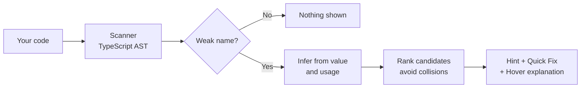

<div align="center">

<!-- Replace with your real icon: 128x128 PNG -->


# Naming Helper
> **Helps beginner developers write better variable names by detecting weak names and suggesting clearer, context-aware alternatives.**

Naming Helper scans your JavaScript and TypeScript files in real-time, detects weak placeholder names (like `x`, `temp`, `data2`, `res`), infers what the variable actually represents from its initializer and usage, suggests clearer names, and explains **WHY** in beginner-friendly language.

It works **100% offline** using AST analysis rules. Optional AI assistance is opt-in and privacy-preserving.

**Stop naming things `x`, `temp`, and `data2`.**
Smart, beginner-friendly variable naming suggestions that teach you *why*, not just *what*.

[](https://code.visualstudio.com/)
[](https://www.typescriptlang.org/)
[](#-privacy-first)
[](LICENSE)
[](#-contributing)

<!-- Replace with a short GIF showing: weak name -> hint -> quick fix -> renamed -->


</div>

---

## Why Naming Helper?

Naming is one of the hardest skills in programming, and one of the least taught. Beginners often end up with code like this:

```js
const x = document.getElementById('submit');
const data2 = await fetch(url);
let temp = 0;
```

Linters will tell you *that* something is wrong. Naming Helper tells you **what the variable actually is**, suggests a better name, and explains the reasoning in plain English, so you get better at naming every time you use it.

```js
const submitElement = document.getElementById('submit');
const response = await fetch(url);
let count = 0;
```

## Features

| | Feature | What it does |
|---|---|---|
| 🔍 | **Weak name detection** | Flags blocklisted names, stray single letters, trailing numbers, and names that contradict their type |
| 🧠 | **Smart inference** | Works out a better name from how the variable is created *and* how it's used |
| ⚡ | **Safe one-click rename** | Uses VS Code's own rename provider, so every reference updates correctly with no blind find-and-replace |
| 🎓 | **Teaches as you go** | Hover any flagged name for a short, beginner-friendly explanation and a naming tip |
| 📊 | **Naming Score** | A status bar percentage showing how well-named your current file is |
| 🤫 | **Low-noise by design** | One hint per declaration, confidence thresholds, and a "don't suggest this again" option |
| 🔒 | **Offline and private** | All core features run locally with no network access and no telemetry |
| 🤖 | **Optional AI mode** | Opt-in AI suggestions for tricky cases, sending only the enclosing function |

## How it works



1. **Detect:** the scanner parses your file and finds every variable, parameter, and destructured binding.
2. **Infer:** rules look at the initializer (`[]`, `new Date()`, `fetch(...)`) and at usage (`.length`, `if (x)`, being passed to a function).
3. **Suggest:** the top candidates (maximum 3) are ranked by confidence, checked for scope collisions, and shown as a gentle hint.
4. **Apply:** pick a quick fix and the symbol is renamed everywhere it's used.

## Examples

### Naming from the initial value

| Your code | Suggested name |
|---|---|
| `const x = []` | `items` |
| `const x = await fetch(url)` | `response` |
| `const x = await res.json()` | `data` or `parsedResponse` |
| `const x = new Date()` | `date` |
| `const x = document.getElementById('submit')` | `submitElement` |
| `const x = document.querySelector('.card')` | `cardElement` |
| `const x = users.filter(...)` | `filteredUsers` |
| `const x = users.find(...)` | `user` |
| `const x = a > b` | `isGreater` |
| `let x = 0` (then `x++`) | `count` |

### Naming from usage

| What the code does | What it suggests |
|---|---|
| `x.length`, `x.push(...)`, `x.map(...)` | A plural noun, because it's a collection |
| `if (x) { ... }` | An `is`/`has`/`should` prefix, because it's a boolean |
| `sendEmail(x)` where the parameter is `address` | `address` |
| `users.map(x => x.name)` | `user` |
| TypeScript type `User[]` | `users` |

### What it leaves alone

By default, these are **not** flagged:

- `i`, `j`, `k` in `for` loops
- `e` in `catch` clauses and event handlers
- `_` for intentionally unused values
- `x`, `y`, `z` in coordinate-like code
- Anything in `node_modules`, `dist`, `*.min.js`, `*.d.ts`, or generated files

## Installation

**From the Marketplace**

1. Open VS Code and go to Extensions (`Ctrl+Shift+X` / `Cmd+Shift+X`).
2. Search for **Naming Helper**.
3. Click **Install**.

**From a `.vsix` file**

```bash
code --install-extension naming-helper-0.1.0.vsix
```

**Running from source**

```bash
git clone https://github.com/YOUR_USERNAME/naming-helper.git
cd naming-helper
npm install
npm run compile
```

Then press `F5` to launch the Extension Development Host.

> **Using Antigravity, Cursor, or another VS Code fork?** These often use the [Open VSX](https://open-vsx.org/) registry. Search there, or install the `.vsix` directly.

## Quick start

1. Open any `.js`, `.ts`, `.jsx`, or `.tsx` file.
2. Write a weak name, for example `const x = [];`.
3. Look for the subtle underline, then press `Ctrl+.` / `Cmd+.` and choose **Rename 'x' to 'items'**.
4. Hover the name to read why.

## Commands

Open the Command Palette (`Ctrl+Shift+P` / `Cmd+Shift+P`) and type "Naming Helper".

| Command | Description |
|---|---|
| `Naming Helper: Scan Current File` | Forces a scan, including very large files |
| `Naming Helper: Show Report` | Lists all flagged names in the file; select one to jump to it |
| `Naming Helper: Explain Naming Rules` | Opens a short guide to the naming rules used |
| `Naming Helper: Enable/Disable` | Turns the extension on or off |
| `Naming Helper: Suggest Better Name With AI` | Optional AI suggestion (disabled by default) |

## Settings

All settings live under `namingHelper.*` in your VS Code settings.

| Setting | Default | Description |
|---|---|---|
| `namingHelper.enable` | `true` | Turn the extension on or off |
| `namingHelper.severity` | `"Hint"` | Diagnostic level: `Hint`, `Information`, or `Warning` |
| `namingHelper.confidenceThreshold` | `0.6` | Only show suggestions at or above this confidence (0 to 1) |
| `namingHelper.blocklist` | *(see below)* | Names that are always considered weak |
| `namingHelper.allowedSingleLetters` | `["i","j","k","e","_"]` | Single-letter names that are never flagged |
| `namingHelper.ignoredNames` | `[]` | Names you never want suggestions for |
| `namingHelper.excludeGlobs` | `node_modules`, `dist`, `*.min.js`, `*.d.ts` | Files and folders to skip |
| `namingHelper.debounceMs` | `500` | Delay before re-scanning after edits |
| `namingHelper.showStatusBar` | `true` | Show the Naming Score in the status bar |
| `namingHelper.ai.enabled` | `false` | Enable the optional AI command |

**Default blocklist:** `x`, `temp`, `tmp`, `data`, `data2`, `foo`, `bar`, `baz`, `val`, `value`, `res`, `arr`, `obj`, `thing`, `stuff`, `item1`, `list1`

**Example `settings.json`**

```json
{
  "namingHelper.severity": "Information",
  "namingHelper.confidenceThreshold": 0.7,
  "namingHelper.allowedSingleLetters": ["i", "j", "k", "e", "_", "n"],
  "namingHelper.ignoredNames": ["data"]
}
```

## Privacy first

- **Core features are 100% offline.** Scanning, inference, and renaming all run on your machine.
- **No telemetry.** Nothing about you or your code is collected.
- **AI is opt-in and off by default.** If you enable it, only the enclosing function and the variable name are sent, never the whole file.
- **You see what is sent.** A one-time consent notice explains it before the first request.
- **API keys are stored securely** using VS Code's `SecretStorage`, never in plain-text settings.

## Supported languages

| Language | Status |
|---|---|
| JavaScript (`.js`, `.jsx`) | Supported |
| TypeScript (`.ts`, `.tsx`) | Supported (best results, thanks to type information) |
| Python, Java, Go, and others | Planned |

## Project structure

```
naming-helper/
├── src/
│   ├── extension.ts        # Activation, command and provider registration
│   ├── scanner.ts          # Parses documents, finds declarations
│   ├── rules/
│   │   ├── badNames.ts     # Blocklist, single-letter, trailing-number logic
│   │   ├── fromValue.ts    # Infers names from initializers
│   │   └── fromUsage.ts    # Infers names from usage
│   ├── suggester.ts        # Ranks candidates, avoids scope collisions
│   ├── diagnostics.ts      # Hint-level diagnostics
│   ├── codeActions.ts      # Quick fixes
│   ├── hover.ts            # Beginner-friendly explanations
│   ├── statusBar.ts        # Naming Score
│   ├── ai.ts               # Optional AI command
│   ├── config.ts           # Settings reader
│   └── types.ts            # Shared interfaces
├── src/test/               # Unit and integration tests
├── test-fixtures/
│   └── sample.js           # Manual testing file with weak-name examples
└── package.json
```

Rules are **pure functions**, so they can be unit tested without launching VS Code.

## Development

```bash
npm install            # install dependencies
npm run compile        # build with esbuild
npm run watch          # rebuild on change
npm run lint           # run ESLint
npm test               # run unit and integration tests
npx vsce package       # build a .vsix
```

**Debugging**

1. Open the project in VS Code (or Antigravity).
2. Press `F5` to start the Extension Development Host.
3. In the new window, open `test-fixtures/sample.js` and look for hints.

## Roadmap

- [x] Weak name detection (blocklist, single letters, trailing numbers)
- [x] Value-based name inference
- [x] Usage-based name inference
- [x] Safe rename via quick fix
- [x] Hover explanations and Naming Score
- [ ] Optional AI suggestions (in progress)
- [ ] Python support (snake_case aware)
- [ ] Function and class name suggestions
- [ ] Team-shared naming conventions file
- [ ] Workspace-wide naming report
- [ ] Localized explanations

Have an idea? [Open an issue](https://github.com/YOUR_USERNAME/naming-helper/issues).

## Contributing

Contributions are welcome, whether it's a new naming rule, a bug fix, or a doc improvement.

1. Fork the repository
2. Create a branch: `git checkout -b feature/my-new-rule`
3. Add your rule in `src/rules/` along with unit tests
4. Run `npm test` and `npm run lint`
5. Open a pull request describing the before and after

**Good first contributions**

- Add a new initializer pattern to `fromValue.ts`
- Add more entries to the default blocklist
- Improve a hover explanation to be clearer for beginners
- Report a false positive with a code snippet

## FAQ

**Will this slow down my editor?**
No. Scans are debounced, limited to changed files, and skipped for very large files unless you run the scan command manually.

**Why is it not flagging a name I think is bad?**
Suggestions only appear when confidence is above your threshold (default `0.6`). Lower `namingHelper.confidenceThreshold` to see more.

**Why is it flagging a name that's fine in my project?**
Use the **"Don't suggest for this name"** quick fix, or add the name to `namingHelper.ignoredNames`.

**Does it work in minified or generated files?**
No. These are skipped on purpose. You can adjust this with `namingHelper.excludeGlobs`.

**Does it send my code anywhere?**
Not unless you explicitly enable the AI feature. See [Privacy first](#-privacy-first).

## License

Released under the [MIT License](LICENSE).

## Acknowledgements

- The [TypeScript compiler API](https://github.com/microsoft/TypeScript/wiki/Using-the-Compiler-API) for making AST analysis approachable
- The [VS Code Extension API](https://code.visualstudio.com/api) docs and samples
- Every beginner who ever named a variable `x` (that's all of us)

<div align="center">

**If Naming Helper made your code a little clearer, consider giving it a ⭐**

Made with care by [YOUR_NAME](https://github.com/YOUR_USERNAME)

</div>
## 📄 License

MIT

